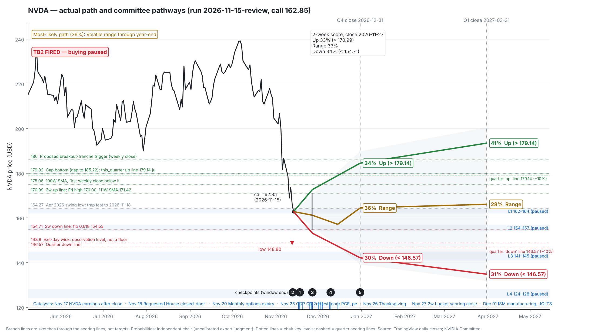

# NVIDIA Committee — Weekly review 2026-11-15

Run `2026-11-15-review` · weekend run · call price 162.85 (Fri 2026-11-13 close) · probabilities: independent chair, uncalibrated expert judgment.

## Final committee decision

> **Strategic: Wait. Tactical: Avoid New Entry.**
>
> **Thesis break:** TB2 stays FIRED, as the chair ruled on 2026-11-12. You have not yet confirmed it or approved an un-pause, so all buying stays paused. TB1 and TB3 have not fired. TB4 has not fired and is not on watch: 0 of 4 hyperscalers are cutting capex.
>
> **What it means for you:** place no ladder orders until you rule on TB2. Reduce does not apply because no position is recorded. Fundamentals are intact, but nobody has said why the CEO left, the legal path is open and the CEO search has barely started.
>
> **Expected** (already priced; only the outcome moves the numbers):
> - NVDA results 2026-11-17 after close. The −12 cut to 2-week range already allows for this. The outcome can move 2-week odds by up to about 10 points.
> - The earnings blackout ends 2026-11-17 and the 10-Q follows. No effect while TB2 governs buying.
> - Options expiry 2026-11-20; weekly closes 2026-11-20 and 2026-11-27. The thin post-Thanksgiving session on 2026-11-27 scores the 2-week bucket.
> - Macro calendar: GDP/core PCE 2026-11-25, ISM 2026-12-01, NFP 2026-12-04, FOMC 2026-12-09, CPI 2026-12-10 (forecast 3.9 vs 3.7). Already counted as a mild headwind in this quarter's down bucket; only a surprise moves it.
>
> **What would change it** (each trigger checked against NVDA's history: % = share of past windows of the same length in which the level was reached):
> - Trap: a daily close back above 164.27 on 2026-11-16, 11-17 or 11-18 (53.5%). 2-week call moves toward 40/30/30.
> - A daily close above 170.99 by 2026-11-20 with NVDA beating SOX that week (29.8%). 2-week up above 40; next quarter back toward 44/27/29.
> - A daily close below 154.71 by 2026-11-20 (23.3%). 2-week down above 45.
> - A daily close below 148.80 by 2026-11-27 with SOX flat or up (20.0%). Quarter down buckets toward 38; L3 in play.
> - A daily close above 179.92 by 2026-11-27 (22.0%). This-quarter up to 45 or more.
> - A weekly close above 175.06 by 2026-12-31 (66.2%). This-quarter up toward 40.
> - A weekly close above 186 by 2026-12-31 (43.4% on daily closes; a weekly close is harder). Quarter up buckets above base rate.
> - A daily close below 140.76 by 2026-12-31 (26.9%). The 200W SMA zone becomes the target.
> - A close below 123.6 by 2027-03-31 (24.5%). Long-term uptrend broken; strategic re-decision.
> - Event triggers: a guide with no sequential growth over $96.2B or gross margin below 72% (up about −10 everywhere); the 10-Q's explanation of the cash-flow drop and the debt rise, and any new legal language; what Huang tells the House briefing; TB1, TB3 or TB4 firing; the TB2 un-pause case; the lowest analyst target cut below 162.85.

## Bottom line + what changed

NVDA closed the week at 162.85 (−12.7% close to close, −33.1% from the ATH). Thursday's exit-day low of 148.80 held, but Friday gave back the rebound and made the first daily close below the April 2026 swing low of 164.27. The committee is close to even for the next two weeks: one binary print and the briefing are both inside the window. The quarters lean only mildly up.

**What changed since 2026-11-12:**
- No charges against anyone. The House briefing is voluntary and closed-door.
- A shareholder class action has been filed, and the D&O cover is Side A only.
- Commerce is drafting Southeast Asia rules.
- Six or more downgrades; the average target fell from 309.21 to 286.12.
- The chair accepted the red team's case that the next-quarter up lean was overstated. The relative decline against SOX and the cash-conversion drop both started before the 8-K.

Coverage: 12/14 pages ok (2 stale, 0 failed, 0 missing; 1 deferred)

## Macro

Purple List, closes of 2026-11-13:
- **Rates:** 10Y 5.139, 30Y 5.47, real 10Y 2.86 (+0.08). 10y–3m +0.83; 10y–2y +0.27. Fed funds 4.0 against CPI 3.7.
- **Credit and conditions:** HY OAS 3.2 (−0.1); NFCI −0.46; 4-week jobless claims 195250.
- **Activity:** ISM PMI 55.5, new orders 55.5.
- **Dollar and FX:** DXY 103.41; USDJPY 159.716.
- **Volatility:** VIX 19.29 (−30.31% on the week).
- **Breadth is rotating away from mega-caps:** RSP +4.04% vs SPY −2.65% over a month (ratio 0.2932). S5TH (share of S&P stocks above their 200D) is 63.81%.

Dated catalysts: retail sales and NVDA results 2026-11-17 · House briefing request 2026-11-18 · opex 2026-11-20 · GDP/core PCE 2026-11-25 · ISM 2026-12-01 · NFP 2026-12-04 · FOMC 2026-12-09 · CPI 2026-12-10 · PPI 2026-12-15.

## Technicals

- **1W:** RSI14 32.53 on a completed bar. That is not oversold (threshold 30); at the April 2025 low it was 35.7. RSI7 18.35, Stoch RSI 0/0. MACD −1.99 is below its signal of 4.5. Price is below the 100W SMA 175.06 (−7.0%) and above the 200W SMA 123.6 (+31.8%). The owner's 111W SMA is at 171.42. The weekly candle opened 173.07, high 179.92, low 148.80, close 162.85. Summary SELL; MAs STRONG_SELL.
- **1D:** RSI14 24.86, ADX 41.5 (a strong trend). Price is 20.2% below the 200D. HullMA9 161.64 sits just under price. Two green BBPCT up-triangles printed (Nov 10–13) and BBPCT is back above 0 at 3.75. The Equity Bottom checklist that uses them is a draft and not back-tested. ATR 9.98 (6.1%).
- **4H:** RSI14 28.08, ADX 42.0. The MACD histogram (−1.22) is converging. Price did not reclaim the 4H SMA20 at 183.18.
- **Structure:**
  - The gap from 179.92 to 185.22 is unfilled.
  - Linear fibs from 10.81 to 243.37: 0.65 = 161.98, 0.618 = 154.53, 0.5 = 127.09.
  - Volume on Nov 12 was 747707648 shares against a 60-day average of 144919900. Friday's volume was 2.5x the 60-day average.

## Fundamentals

- **Last quarter:** revenue $96.2B (+105.9% YoY); gross margin 74.7%, operating margin 65.2%, net margin 63.7%.
- **Valuation:** forward P/E on next fiscal year 17.51; P/E TTM 20.59.
- **Cash flow and debt, the open question:** FCF $21.4B against $48.6B the quarter before. Total debt went from $12.8B to $38.9B. The cause is not in the data.
- **The print, 2026-11-17 after close:** the company guided $108B ±2%. Consensus revenue is $108.85B with EPS 2.47 on TradingView; Benzinga shows about $109.2B / 2.48. The implied move of about 9.1% is a second-hand news figure because options data is deferred.
- **Analysts** are one evidence group with near-zero weight. Holds rose from 9 to 15, the average target is 286.12 and the low target is 170.

## Relative strength

- NVDA/SOX is at 16.0501: −11.5% over 13 weeks and −42.5% over 52 weeks.
- This week NVDA fell 14.78% while SOX rose 6.86%, AMD 20.17%, AVGO 11.53% and SPX 2.49%. Year to date, NVDA is −14.21% against AMD +143.97%.
- Beta is 1.52 to SPX and 0.48 to SOX.

The weakness is specific to Nvidia and does not point to an AI-demand break. The relative decline also started well before the 8-K.

## Sentiment

Both sentiment gauges are stale (from before the 8-K) and are treated as unknown:
- AAII, week ending 2026-11-04: bearish 48.4, bullish 34.1.
- CNN Fear & Greed: 20 (Extreme Fear) on 2026-11-06.

What is current: VIX 19.29, the climax volume on Nov 12, and the six straight weekly declines. Capitulation therefore rests only on volume and bar shape.

## Narrative & governance

- **The exit:** the 8-K says the CEO resigned effective immediately, gives no reason and reports no disagreement. Kress is interim CEO and Jones is Chair. The search for a permanent CEO is open; Rene Haas was approached and Kurian is reported as considered.
- **Congress:** three House chairs asked Huang for a closed-door briefing on 2026-11-18. It is voluntary.
- **Megaspeed:** Megaspeed denies wrongdoing. Alice Huang left on 2025-08-30, and Megaspeed has opened its own internal probe. Bloomberg reports that a company she founded obtained banned chips through OEM servers. WSJ reports about $12B of Megaspeed-arranged shipments, but delivery is not established.
- **Export rules:** Commerce is drafting rules for Malaysia, Indonesia and Singapore, and the administration is split (Lutnick favours narrower controls).
- **Litigation:** a class action has been filed, with D&O cover Side A only (up to $900M).
- **TB4 capex monitor:** 0 of 4 hyperscalers falling. Run-rate vs TTM: MSFT +15.9%, GOOGL +28.5%, AMZN +43.6%, META +30.0%. No capex-guidance cut has been reported.

## Kahneman — System 1 vs System 2

### System 1 (fast reactions)
- "Weekly RSI is oversold, so buy." It is 32.53 on a completed bar, which is above 30.
- "148.80 was the capitulation low." It is one wick in a 6.1% ATR tape.
- "Six downgrades means the bottom is in." Analyst actions lag price.

### System 2 (the slow check)
- Start from the base rates (2 weeks 33/45/22, this quarter 39/43/18, next quarter 50/31/19). They come from a 2021–2026 bull-run sample.
- Count each evidence group once: event variance, governance, momentum, analysts.
- The n=13 and n=4 conditional tables are context only. They come from overlapping windows and none of them includes a CEO exit.

## Outlook

Measurement thresholds:
- **2 weeks:** up above 170.99, down below 154.71, measured at the close on or before 2026-11-29 (Fri 2026-11-27).
- **Quarters:** up above 179.14, down below 146.57, measured at the 2026-12-31 and 2027-03-31 closes.

| Window | Up | Range | Down | Base rate (up / range / down) |
|---|---|---|---|---|
| Next 2 weeks | 33 | 33 | 34 | 33 / 45 / 22 |
| This quarter (to 2026-12-31) | 34 | 36 | 30 | 39 / 43 / 18 |
| Next quarter (to 2027-03-31) | 41 | 28 | 31 | 50 / 31 / 19 |

Chair confidence: 35 (down from 40). The reasons are the stale sentiment pages, the missing options data and the binary print.

## Expected path

**Most-likely path (36%):** a volatile range through year-end. The 2026-12-31 close lands between 146.57 and 179.14, with no daily close below 148.80 and no fill of the gap.

Last run's checkpoints, rescored:
- Checkpoint 1 is **invalidated**: Friday closed at 162.85, below 164.27.
- Checkpoints 2 to 5 were stale and have been redrawn.

| # | Window | Confirm | Invalidate | Status |
|---|---|---|---|---|
| 1 | 2026-11-16 to 2026-11-18 | Close back above 164.27, or holds above 158.39 into the print | Close below 154.71 by 2026-11-20 | pending |
| 2 | 2026-11-17 to 2026-11-18 | Guide shows sequential growth over $96.2B; gross margin near 74.7%; benign cash/debt explanation; no new legal language | No sequential growth or gross margin below 72%; new legal language or a reported admission | pending |
| 3 | 2026-11-18 to 2026-11-27 | No close below 148.80; NVDA/SOX not below 16.05 | Close below 148.80 with SOX flat or up, or close above 179.92 | pending |
| 4 | 2026-11-30 to 2026-12-10 | Closes stay between 148.80 and 179.14 through FOMC/CPI | Close below 146.57, or weekly close above 186 | pending |
| 5 | 2026-12-11 to 2026-12-31 | 2026-12-31 close between 146.57 and 179.14 | Close outside that band | pending |

## Ladder Audit

The ladder is still **PROPOSED** (2026-11-11). It has no budget and no recorded holdings. **TB2 pause: no fills.**

History: L1 to L4 are all "resting (proposed)". There are no pre-ladder fills and no dropped or filled orders.

| Order | Zone | Weight | Distance from price | Anchors (drift) | Gap to previous order |
|---|---|---|---|---|---|
| L1 | 162–164 | 1.0 | +0.1% | fib 0.65 161.98 (0.6); April 2026 low 164.27 (−0.8), lost on a close | — |
| L2 | 154–157 | 1.5 | −4.5% | fib 0.618 154.53 (0.6); July 2025 closes 157.75 (−1.4) | 4.8% |
| L3 | 141–145 | 2.0 | −12.2% | 2024 range top 140.76 (1.6); July 2025 base 143.85 (−0.6) | 8.7% |
| L4 | 124–128 | 3.0 | −22.6% | 200W SMA 123.6 (1.9); fib 0.5 127.09 (−0.9) | 13.5% |

If filled down to each level: through L1 13.3% of budget at 163.00; through L2 33.3% at 158.42; through L3 60.0% at 151.17; through L4 100% at 139.99.

**Chair proposals for you** (none applied):
- **L1 anchor weakened.** It now rests only on the linear fib, so re-check it after the trap window closes on 2026-11-18. The 2026-11-12 proposal to merge L1 into L2 (one 154–157 zone, weight 2.5) still stands, because the 4.8% spacing is less than one daily ATR (6.1%).
- **No level at the 148.80 wick.** It is a one-day print, not structure.
- **L4 sizing** (information only). L4 carries 40% of the weights, but 123.6 was reached by 2027-03-31 in only 24.5% of past windows, and its 200W SMA anchor drifts up every week.
- **Breakout tranche** (weekly close above 186) is unchanged.

## Strategy

Wait while TB2 stands. The fundamentals and sentiment members argued for "accumulate on valuation". The chair rejected it while a thesis break stands, and even without TB2 it rests on estimates the print has not yet tested.

The un-pause test is proposed to you. All five conditions are needed:
1. The exit reason is stated as unrelated to legal or regulatory matters.
2. The release and 10-Q add no new Nvidia-level legal language.
3. TB1 and TB3 have not fired.
4. A permanent CEO is named, or a credible search timeline is given.
5. You approve.

## Thesis-break update

| Rule | Status | Evidence |
|---|---|---|
| TB1 export violations confirmed | NOT FIRED | No charge, settlement, penalty or admission against Nvidia; OEM-channel diversion reports only |
| TB2 CEO leaves under legal/regulatory pressure | FIRED (2026-11-12 ruling stands; not yet confirmed by you) | No reason given; House briefing request; class action; board investigation and DOJ inquiry reported 2026-11-12 with no finding |
| TB3 new export restrictions enacted | NOT FIRED | Commerce drafting; administration split; nothing enacted |
| TB4 hyperscaler capex cuts | NOT FIRED, NOT ON WATCH | 0 of 4 falling; no guidance cut |

Re-check TB2 after the print and 10-Q, and after the briefing.

## Committee

| Member | Next 2 weeks (U/R/D) | This quarter | Next quarter | Conf |
|---|---|---|---|---|
| Technical | 34 / 30 / 36 | 31 / 37 / 32 | 42 / 27 / 31 | 40 |
| Macro | 32 / 35 / 33 | 35 / 36 / 29 | 44 / 27 / 29 | 25 |
| Fundamentals | 37 / 35 / 28 | 40 / 35 / 25 | 50 / 25 / 25 | 42 |
| Relative strength | 31 / 37 / 32 | 33 / 40 / 27 | 43 / 31 / 26 | 38 |
| Sentiment | 34 / 28 / 38 | 35 / 30 / 35 | 43 / 23 / 34 | 30 |
| Narrative | 35 / 31 / 34 | 33 / 35 / 32 | 41 / 28 / 31 | 48 |
| Red team | 35 / 33 / 32 | 35 / 37 / 28 | 40 / 28 / 32 | 35 |
| **Chair** | 33 / 33 / 34 | 34 / 36 / 30 | 41 / 28 / 31 | 35 |

**How the chair ruled** (the chair ruled each point; it did not average the members):
- **Event variance:** applied once as −12 on 2-week range, not the 7–17 points each member cut.
- **Governance:** one group, counted once. It is already in the call price.
- **Momentum:** one group. The trend readings and the stretched-oscillator readings offset each other.
- **Next quarter:** the chair sided with the red team over fundamentals (50 up). The relative decline, the six straight weekly declines and the cash-flow drop all predate the 8-K.
- **Analyst targets:** near-zero weight.

## Performance review

No forecasts resolved yet. 24 trial forecasts are pending, and the first resolves at the 2026-11-25 close. Status: uncalibrated, fewer than 20 resolved forecasts.

## Dashboard

| Item | Value |
|---|---|
| Price / week | 162.85 / −12.7% |
| Drawdown from ATH 243.37 | −33.1% |
| 100W / 200W / 200D | −7.0% / +31.8% / −20.2% |
| Weekly RSI14 (completed bar) | 32.53, not oversold |
| ATR daily | 9.98 (6.1%) |
| NVDA/SOX 13 weeks / 52 weeks | −11.5% / −42.5% |
| Hyperscalers cutting capex | 0 of 4 |
| Thesis breaks | TB2 FIRED (pending your confirmation) |
| Coverage | 12/14 ok, 2 stale, 1 deferred |

## Sources

| Page | Status | Read (UTC) |
|---|---|---|
| tv_technicals_1w | ✓ | 2026-11-15T15:24:00Z |
| tv_technicals_1d | ✓ | 2026-11-15T15:24:00Z |
| tv_technicals_4h | ✓ | 2026-11-15T15:24:00Z |
| nvda_ohlcv | ✓ | 2026-11-15T15:24:00Z |
| tv_chart_owner (your layout, not saved) | ✓ | 2026-11-15T16:06:00Z |
| tv_purple_list | ✓ | 2026-11-15T16:09:00Z |
| tv_relative | ✓ | 2026-11-15T15:24:00Z |
| tv_fundamentals | ✓ | 2026-11-15T15:26:00Z |
| economic_calendar | ✓ | 2026-11-15T15:26:00Z |
| news_governance | ✓ | 2026-11-15T15:50:00Z |
| sec_filings | ✓ | 2026-11-15T16:10:00Z |
| hyperscaler_capex | ✓ | 2026-11-15T15:15:00Z |
| sentiment_aaii | stale (week ending 2026-11-04) | 2026-11-15T15:40:00Z |
| sentiment_cnn_fg | stale (2026-11-06 / 2026-11-11) | 2026-11-15T15:40:00Z |
| options_positioning | ✗ deferred by owner | — |

Event cutoff: 2026-11-13T21:00Z. **After 2026-11-17 21:00 UTC every price-sensitive page is stale. No post-print memo may go out until they are re-read.**
