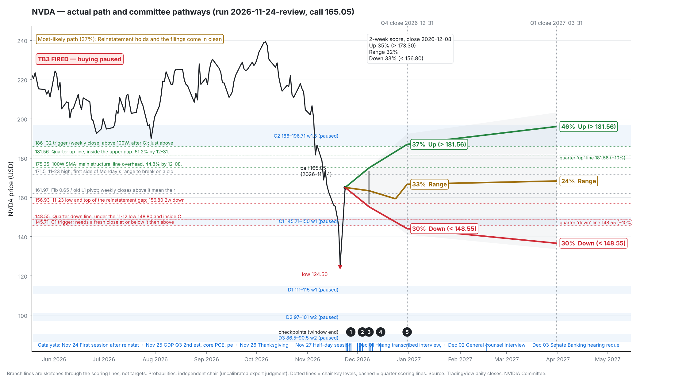

# NVIDIA Committee — Review 2026-11-24 (Huang reinstated)

Run `2026-11-24-review` · pre-market Tuesday · call price 165.05 (Mon 2026-11-23 close) · probabilities: independent chair, uncalibrated expert judgment.

## Final committee decision

> **Strategic: Hold. Tactical: Wait.**
>
> **Thesis breaks:**
> - **TB2: CLEARED (premise reversed).** The chair cleared it on 2026-11-24 and re-armed it; your confirmation is needed to record it. The board reinstated Huang as President, CEO and director, so the departure behind TB2 no longer exists. Whether the original firing was right can't now be decided.
> - **TB3: FIRED (provisional on materiality), unchanged.** The remote-access rule is still in force and no licence decisions have been reported. This is what still pauses buying.
> - **TB1: NOT FIRED.**
> - **TB4: NOT FIRED, NOT ON WATCH.**
> - **TB5 (proposed): WATCH, with a hard checkpoint at the 10-Q deadline (about 2026-12-04).**
>
> **What it means for you:**
> - **Buying stays paused under TB3**, and the ladder stays dormant before the gate-opening date (G).
> - **Your 30 shares at $171 are at −3.5%.**
> - **Reduce:** under the rules it is technically *available*, but only because TB3 has fired, and TB3 is provisional and unconfirmed by you. If you rule TB3 not fired or immaterial, Reduce stops being available. This is a committee ruling, not advice. The committee's stance is **Hold**, and neither your $171 cost nor Monday's 171.50 high is a level for any decision.
>
> **Expected** (already priced; only the outcome moves the numbers):
> - **Thanksgiving week:** closed 2026-11-26, half-day 2026-11-27. Weekly closes 2026-11-27 and 2026-12-04; the 2-week call is scored at the 2026-12-08 close.
> - **Q3 10-Q deadline about 2026-12-04.** It is the main 2-week binary, already counted once in the governance group.
> - **Requested congressional sessions 2026-12-01 to 12-03.** Their status since the reinstatement is not confirmed.
> - **Ex-dividend 2026-12-02.** Immaterial.
> - **Macro calendar:** GDP/core PCE 2026-11-25, ISM 2026-12-01, NFP 2026-12-04, FOMC 2026-12-09, CPI 2026-12-10 (forecast 3.9 vs 3.7).
> - **Next quarter:** the licence deadline about 2027-02-17 and the Q4 FY27 results in late Feb 2027.
>
> **What would change it** (% = share of past windows of the same length in which the level was reached):
> - **Reversal day extended:** a close above 171.50 by 2026-12-08 before any close below 156.93 (60.1%). 2-week call toward 40/30/30.
> - **Weekly trend repair:** a close above 175.25 (100W SMA) by 2026-12-08 (44.8%).
> - **Reinstatement gap failing:** two consecutive closes below 156.80 without a reclaim of 156.93, by 2026-12-08 (41.2%). 2-week down toward 45–50.
> - **A 2026-11-27 weekly close at or below 156.93** (19.0%). −5 from up in both quarters.
> - **A close below 148.55 by 2026-12-08** (17.5%) or by 2026-12-31 (35.7%). The stock-specific discount is back.
> - **A close at or below 145.71 by 2026-12-31** (30.3%). The rally has fully failed; this is also the first half of C1's fresh qualifying close.
> - **A close above 179.92 by 2026-12-31 that holds above 175.25** (55.0%).
> - **A close above 186 by 2026-12-31** (41.3%).
> - **A close at or below 125.53 by 2027-03-31** (24.2%). The full reinstatement gap is filled.
> - **Event triggers:**
>   - The 10-Q is filed clean (bullish).
>   - The 10-Q misses its deadline, shows a material weakness or restatement, or Nvidia confirms a formal SEC investigation (bearish).
>   - A credible report from the congressional sessions that Nvidia knew of the diversion.
>   - TB2 re-fires on adverse investigation findings.
>   - TB3 licence grants or a company quantification.
>   - NVDA/SOX weekly readings against 17.21.
>   - FOMC/CPI.
>   - Late-Feb revenue below $126.1B.

## What signalled the move

**What happened:** before Monday's open, Nvidia's board unanimously reinstated Jensen Huang as President, CEO and director. The board cited "input from senior levels of the United States government" and said it was confident he poses no national security risk. NVDA closed +31.48% at 165.05, about $950B of added value and its best day since May 2003. More than 11M option contracts traded, a record for NVDA. Reported afterwards: Trump dialled into the Sunday 2026-11-22 board meeting, and the administration assured directors that Huang was not a national-security threat and was not facing criminal charges.

**Public signs before the move, in date order:**

| Date | Signal | Read at the time |
|---|---|---|
| Nov 10 (reported Nov 12) | Trump called Huang and urged him to fight for his job | Support, not a decision |
| Nov 14 | Altimeter and Atreides (about $2.13B of shares) asked the board to keep Huang's return open | Large holders lobbying |
| Nov 16 | Trump said he "would not mind" a return; the "Stand With Jensen" petition passed 178k signatures; Musk backed Huang | Political and social pressure |
| Nov 17 | Huang said he would be "honored" to return | Candidate willing |
| Nov 17 | Board chair: board "does not intend to reinstate" | **Strong counter-signal** |
| Nov 20 | Trump said Huang should apologise and go back (time of day unknown) | Escalating pressure |
| Sun Nov 22 | Trump's post urging a rehire; Bessent: "he's on the outside now" | **Explicit, public before Monday's open** |

**The chair's verdict on which signs were genuinely predictive:**
- **Genuinely predictive:** the dated political sequence. It bore on the catalyst itself and justified a non-zero probability of a reversal. The committee gave that reversal zero probability: the 2026-11-15 narrative member filed Trump's comments and the petition as "noise", and the TB2 un-pause test had no reinstatement path.
- **What the sequence did not predict:** the *timing*. The board chair's "does not intend" on Nov 17 was a real counter-signal, and the most explicit signals (Sunday) came after our Sunday news read.
- **Conditions, not predictors:** weekly RSI 25.01, daily RSI 15, the 200W SMA confluence, VIX 35.9 and 8.4x forward earnings. All were true on Nov 20 and would have stayed true if the board had held firm. They set the *size* of the move once a catalyst arrived, not whether it came.
- **Hindsight relabels:** calling Friday's 633M volume "climactic", and the "four-way confluence at 124". Both were picked out only after the level held.
- **Not predictable:** the size and date. One-day moves of +15% or more happen on 0.32% of NVDA days.

**Lesson candidates (proposals for you, none applied):**
1. Every reversible governance state gets an explicit reversal probability in every run, with its dated signals listed.
2. Weigh political signals by the sender's leverage over the decision-maker. A President or a Commerce or Treasury head talking about a company that depends on their licences is signal. Petitions and senators' statements stay near noise. Official documents remain the only bar for firing or clearing a thesis break.
3. A statement of intent ("does not intend to reinstate") is not a decision. Never label a governance state permanent without a structural lock.
4. Do not call a level break confirmed before its 1–3 close trap clock has run.
5. The chair tabulates which evidence each member used and counts shared items once.

## Bottom line + what changed

NVDA closed at 165.05 (+31.48% on the day, +31.5% on the week so far, 32.2% below the ATH). That is about the exit-day close (166.19), not a full recovery. The business numbers didn't change, and neither did the open accounting items: the SEC inquiry, the 10-Q due about 2026-12-04, and the 12-01 to 12-03 sessions. Counting the shared down items once, the 2-week call is two-sided and the quarters lean mildly up.

**What changed since 2026-11-22:**
- TB2's premise was reversed.
- Last run's checkpoint 1 was confirmed: there was no close below 124.14.
- C1's price trigger (a close above 145.71) printed **before** gate-opening. Under the re-anchor rule it needs a fresh qualifying close after G, and it is not a fill.
- Last run's forecasts (at 125.53) stay unscored until their resolution close.

Coverage: 10/14 pages ok (4 stale, 0 failed, 0 missing; 1 deferred)

## Macro

Purple List, latest values at 2026-11-23:
- **Rates:** 10Y 4.934, 30Y 5.304, real 10Y 2.77 (−0.11). 10y–3m 0.55; 10y–2y 0.29. Fed funds 4.0 against CPI 3.7.
- **Credit:** HY OAS **3.76 (+0.24)**. Credit widened while stocks rallied, possibly a lagging FRED print. The committee's stress line is 4.0. NFCI −0.48.
- **Activity:** ISM PMI 55.5; 4-week jobless claims 197750.
- **Dollar and FX:** DXY 104.33; USDJPY 159.34.
- **Stress:** VIX 26.61 (−25.8%). S5TH (share of S&P stocks above their 200D) is 53.08 (+7.16).
- **Indices:** SPX 7237.17 (+4.73%), Nasdaq Composite 24089.56 (+6.51%), SOX 9588.05 (+14.03%).

The chair accepted macro as the one independent down input beyond governance: wider credit, CPI above Fed funds, and FOMC/CPI inside the quarter.

## Technicals

- **1W (forming bar, 1 of 4 sessions):** RSI14 40.65; on the completed 2026-11-16 bar it was 25.01. MACD −9.71 against its signal of −0.36. Price is 5.8% below the 100W SMA (175.25) and 32.2% above the 200W SMA (124.86). The weekly candle so far: open 167.04, high 171.50, low 156.93, close 165.05. On your chart, the bottom oscillator printed a green up-triangle on this bar. Summary SELL.
- **1D:** RSI14 42.87, ADX 49.3. Price is 18.8% below the 200D (203.24). ATR 13.22 (8.0%), inflated by Monday's bar and the prior Friday's. Monday gapped up 33.1% and closed below its open (a gap-and-fade bar) but 5.2% above its low.
- **4H:** RSI14 49.97. The MACD (−10.58) crossed above its signal (−12.64).
- **Structure:** a new open gap from 125.53 to 156.93, and the upper gap from 179.92 to 185.22. The SEC-day gap (143.725–145.71) was filled on 2026-11-23.

**Chair's reading:** momentum is one group and nets to about zero on direction.

## Fundamentals

Unchanged since the 2026-11-17 print:
- **Q3:** revenue $115.8B (+103% YoY); data center $107.6B.
- **Q4 guide:** $130B ±3%, assuming zero China data-center compute; next-FY growth forecast about 75%.
- **Guarantees:** maximum $118B, none paid.
- **Valuation:** P/E TTM 20.62.
- **Analysts** (one group, near-zero weight, they follow price):
  - Upgrades on 2026-11-23: Oppenheimer to Outperform (target 250); StoneX to Buy (target 270); Bernstein to Outperform (target 200).
  - Citi raised its target to 240.
- **10-Q:** still not on EDGAR. Management tied the delay to the internal investigation. The deadline is about 2026-12-04.

## Relative strength

- NVDA/SOX is at 17.2141 at Monday's close, against 14.9288 at the last completed week.
- The 13-week and 52-week changes (−18.4% / −46.5%) are on completed weeks.
- On the day NVDA rose 31.48% against SOX +14.03%, SMH +15.03%, AMD +6.85% and SPX +4.73%. Over the rolling 5 sessions NVDA is +3.80% and SOX −1.00%.
- Beta is 1.94 to SPX and 0.62 to SOX.

The test now is whether the ratio holds above 17.21 on the weekly closes of 2026-11-27 and 2026-12-04.

## Sentiment

Both gauges are stale (AAII from the week ending 2026-11-11, CNN from 2026-11-06) and are treated as unknown. What is current: VIX 26.61 (−25.8% on the day), record options volume of unknown direction (options data deferred), and Monday's volume at 4.8x the 60-day average.

**Owner bias check:** your position is close to breakeven. "Back to $171" is an anchor, not a signal, in either direction.

## Narrative & governance

- **Return conditions:**
  - The independent investigation "will proceed to conclusion", and Huang will cooperate.
  - A new National Security and Export Control Committee.
  - A chief compliance officer.
  - Continued cooperation with government inquiries.
- **Still open:**
  - The SEC inquiry, with no company statement.
  - The 10-Q delay.
  - The DOJ/Commerce Megaspeed probe.
  - Congressional requests for 2026-12-01 to 12-03.
  - Goldman sees more scrutiny in some jurisdictions; Baird calls Huang's return plus the chip limits a worst case for China.
- **The political dimension cuts both ways.** It lowers the near-term odds of TB1 (no criminal charges, reported). It may raise the odds of TB3 licences. It also ties Nvidia's governance more closely to the administration.
- **TB4 monitor:** 0 of 4 hyperscalers falling (run-rate vs TTM MSFT +15.9%, GOOGL +28.5%, AMZN +43.6%, META +30.0%).

## Kahneman — System 1 vs System 2

### System 1 (fast reactions)
- "Huang is back, the crisis is over."
- "We should have seen it coming."
- "It's back to my cost, so I'm safe."

### System 2 (the slow check)
- The reinstatement removed one discount but resolved none of the filings.
- The political signs justified a tail probability, not a forecast of Monday.
- Start from the base rates (2 weeks 33/45/22, this quarter 39/43/18, next quarter 50/31/19) and count governance once.

## Outlook

Measurement thresholds:
- **2 weeks:** up above 173.30, down below 156.80, measured at the close on or before 2026-12-08.
- **Quarters:** up above 181.56, down below 148.55, at the 2026-12-31 and 2027-03-31 closes.

| Window | Up | Range | Down | Base rate (up / range / down) |
|---|---|---|---|---|
| Next 2 weeks | 35 | 32 | 33 | 33 / 45 / 22 |
| This quarter (to 2026-12-31) | 37 | 33 | 30 | 39 / 43 / 18 |
| Next quarter (to 2027-03-31) | 46 | 24 | 30 | 50 / 31 / 19 |

Chair confidence: 32. The reasons are four partial or stale pages, no options data, and the open accounting items.

## Expected path

**Most-likely path (37%): the reinstatement holds and the filings come in clean.** That means:
- No weekly close at or below 156.93.
- The 10-Q is filed clean.
- The sessions add no account that Nvidia knew of the diversion.
- NVDA/SOX holds its repair.
- FOMC/CPI pass without a close below 148.55.
- A 2026-12-31 close above 181.56.

The range branch is at 33% and the down branch at 30%.

Last run's checkpoints, rescored:
- Checkpoint 1 was **confirmed**.
- Checkpoints 2–4 are pending.
- Checkpoint 5 is stale, because it was built on the old 125.53 starting price.

| # | Window | Confirm | Invalidate | Status |
|---|---|---|---|---|
| 1 | 2026-11-24 to 2026-11-27 | No daily close below 156.93; 2026-11-27 weekly close above 161.97 | 2026-11-27 weekly close at or below 156.93, or two consecutive closes below 156.80 | pending |
| 2 | 2026-11-24 to 2026-12-04 | 10-Q filed (on time or within a 12b-25 extension) with no restatement, non-reliance or material-weakness language; no Nvidia-knew account | Extended deadline missed, reporting problem disclosed, formal SEC investigation confirmed, or a credible Nvidia-knew report | pending |
| 3 | 2026-11-27 to 2026-12-08 | NVDA/SOX weekly closes not below 15.5; 2026-12-08 close at or above 156.80 | NVDA/SOX below 15.5 with SOX flat, or 2026-12-08 close below 156.80 | pending |
| 4 | 2026-12-09 to 2026-12-15 | FOMC, CPI and PPI pass with every close above 148.55 | Close below 148.55, or a hike with CPI at or above 3.9 | pending |
| 5 | 2026-12-16 to 2026-12-31 | Close above 175.25, then a 2026-12-31 close above 181.56 | 2026-12-31 close at or below 181.56 | pending |

## Ladder Audit

The ladder was **APPROVED** by you on 2026-11-22 and is **DORMANT** until the gate-opening date (G), which isn't set yet. Budget: $10,000 of new money. Holdings: 30 shares at $171.00 ($5,130), at −3.5%. No ladder orders have filled.

**History** (rows are never removed):
- **Your own order:** 30 shares at $171, filled (not a ladder fill).
- **L1–L4:** cancelled by you on 2026-11-22, never filled. Price closed back just above the old L1 zone on 2026-11-23; that is not a fill.
- **N1:** dropped on 2026-11-22, never approved.

| Order | Type | Zone / trigger | Weight | Distance from price | Reachability (chair, at 165.05) |
|---|---|---|---|---|---|
| D1 | Dip | 111–115 | 1.0 | −31.5% | 115 by 2026-12-31: 2.5% (unreachable); by 2027-03-31: 16.6% |
| D2 | Dip | 97–101 | 2.0 | −40.0% | 101 by 2027-03-31: 4.8% (unreachable) |
| D3 | Dip | 86.5–90.5 | 2.0 | −46.4% | 90.5 by 2027-03-31: 0.9% (unreachable) |
| C1 | Confirmation | close above 145.71, buy up to 150 | 1.0 | −10.4% | Trigger printed 2026-11-23 **before G**: needs a fresh close at or below 145.71, then above it, after G |
| C2 | Confirmation | weekly close above 186 and the 100W, buy up to 196.71 | 1.5 | +15.9% | 186 by 2026-12-31: 41.3% |

If the dip orders all filled, your average cost including the 30 shares at $171 would be: through D1 154.63, through D2 132.83, through D3 119.32.

**Chair proposals (for you; nothing applied, no order to place):**
- **P1 (keep):** D1, C1, C2, the activation conditions and the re-anchor rule stay as approved.
- **P2 (your choice):** D2 and D3 hold 4.0 of the 7.5 weight but are effectively unreachable this horizon.
  - Option A: keep them as long-dated tail levels.
  - Option B (the chair's suggestion): move 1.0 of D3's weight to a new dip row D0 at 125–129. Its anchors are the reinstatement-gap bottom 125.53, the 200W SMA 124.86, the swing low 124.50 and the 0.5 fib at 127.09. A close at or below 128 happened by 2026-12-31 in 7.3% of past windows and by 2027-03-31 in 25.6%. D0 passes the spacing test against D1, but only narrowly.
- **P3 (data):** recompute the reachability figures in the ladder file at each run's price; the stored ones were computed at 125.53.
- **P4 (sequence):** decide TB2 (confirm cleared), TB3 materiality and TB5 adoption before 2026-12-04, so the ladder activates on documents rather than on Monday's price.

## Strategy

Hold. Demand evidence is intact and nothing argues for exiting the thesis. TB3 still pauses buying and the accounting gate is open, so the committee is not accumulating. Don't chase a +31.48% day. The 10-Q is the next real information.

## Thesis-break update

| Rule | Status | Evidence |
|---|---|---|
| TB1 export violations confirmed | NOT FIRED | No charge, settlement or admission naming Nvidia; the administration told the board Huang is not facing criminal charges (reported) |
| TB2 CEO leaves under legal/regulatory pressure | CLEARED (premise reversed), re-armed; you to confirm | Unanimous reinstatement (8-K event date 2026-11-22). Re-fire test: departure after adverse investigation findings, or an official action naming him |
| TB3 export restrictions that materially cut addressable market | FIRED (provisional on materiality), unchanged; you to confirm | Rule in force since 2026-11-19; no licence decisions; deadline about 2027-02-17 |
| TB4 hyperscaler capex cuts | NOT FIRED, NOT ON WATCH | 0 of 4 falling |
| TB5 financial-reporting integrity (proposed) | WATCH; checkpoint at the 10-Q deadline | A permitted 12b-25 extension would not fire it. Missing the extended deadline, or a filing with restatement, non-reliance or material-weakness language, would |

## Committee

| Member | Next 2 weeks (U/R/D) | This quarter | Next quarter | Conf |
|---|---|---|---|---|
| Technical | 38 / 30 / 32 | 36 / 35 / 29 | 46 / 24 / 30 | 33 |
| Macro | 31 / 36 / 33 | 34 / 34 / 32 | 45 / 25 / 30 | 27 |
| Fundamentals | 31 / 33 / 36 | 34 / 33 / 33 | 44 / 24 / 32 | 32 |
| Relative strength | 33 / 31 / 36 | 36 / 32 / 32 | 46 / 24 / 30 | 30 |
| Sentiment | 30 / 34 / 36 | 30 / 38 / 32 | 40 / 28 / 32 | 28 |
| Narrative | 33 / 31 / 36 | 37 / 32 / 31 | 46 / 25 / 29 | 42 |
| Red team | 36 / 32 / 32 | 38 / 33 / 29 | 47 / 24 / 29 | 35 |
| **Chair** | 35 / 32 / 33 | 37 / 33 / 30 | 46 / 24 / 30 | 32 |

**How the chair ruled** (it ruled each point and did not average the members):
- **Governance/filings:** one group, counted once (about 5 points from up to down on 2 weeks). Four members' "36 down" rested on the same three items counted four to six times.
- **Volatility:** one range cut, stopped at 32 because the ATR is inflated by two shock bars.
- **Unproven patterns:** arguments with no historical sample behind them got zero weight, bullish or bearish ("covering rallies fade", "relative strength snaps back then stalls").
- **Correction accepted from the red team:** price has *not* recovered most of the drawdown. It is 11.6% below the last weekly close before the exit and 32.2% below the ATH.

## Performance review

No forecasts resolved yet. 72 forecasts are pending, the first at the 2026-11-25 close. The 2026-11-22 calls (at 125.53) resolve at the close on or before 2026-12-06. They are **not** to be logged as hits or misses before then. Status: uncalibrated, fewer than 20 resolved forecasts.

## Dashboard

| Item | Value |
|---|---|
| Price / day | 165.05 / +31.48% |
| Drawdown from ATH 243.37 | −32.2% |
| 100W / 200W / 200D | −5.8% / +32.2% / −18.8% |
| Weekly RSI14 | 40.65 forming (25.01 on the completed bar) |
| ATR daily | 13.22 (8.0%) |
| NVDA/SOX now / last completed week | 17.2141 / 14.9288 |
| HY OAS / VIX | 3.76 / 26.61 |
| Thesis breaks | TB2 cleared (to confirm), TB3 FIRED provisional, TB5 proposed |
| Your position | 30 shares at $171, −3.5% |
| 10-Q | not filed; deadline about 2026-12-04 |
| Coverage | 10/14 ok, 4 stale, 1 deferred |

## Sources

| Page | Status | Read (UTC) |
|---|---|---|
| tv_technicals_1w | ✓ | 2026-11-24T06:55:00Z |
| tv_technicals_1d | ✓ | 2026-11-24T06:55:00Z |
| tv_technicals_4h | ✓ | 2026-11-24T06:55:00Z |
| nvda_ohlcv | ✓ | 2026-11-24T06:50:00Z |
| tv_chart_owner | stale (partial: 1W only; some fields carried from 2026-11-22; layout not saved) | 2026-11-24T07:20:00Z |
| tv_purple_list | ✓ | 2026-11-24T07:28:00Z |
| tv_relative | ✓ | 2026-11-24T06:56:00Z |
| tv_fundamentals | ✓ | 2026-11-24T06:58:00Z |
| economic_calendar | ✓ | 2026-11-24T07:00:00Z |
| news_governance | ✓ | 2026-11-24T06:45:00Z |
| sec_filings | stale (partial: 8-K body and EDGAR index not opened) | 2026-11-24T07:05:00Z |
| hyperscaler_capex | ✓ (no new quarter since 2026-11-15) | 2026-11-24T07:05:00Z |
| sentiment_aaii | stale (week ending 2026-11-11) | 2026-11-24T06:45:00Z |
| sentiment_cnn_fg | stale (2026-11-06) | 2026-11-24T06:45:00Z |
| options_positioning | ✗ deferred by owner | — |

Event cutoff: 2026-11-23T21:00Z. News sources include Yahoo Finance, CNBC, Motley Fool, Semafor, NBC News, The Jerusalem Post (citing WSJ), Business Standard (citing NYT), CEOWORLD, AP/NPR and Al Jazeera.
